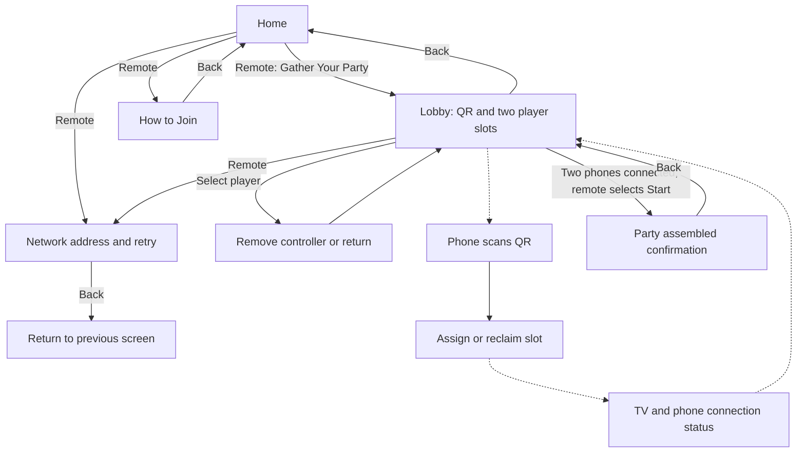

# Implemented lobby flow

Phones have connection UI only: room entry for the fallback URL, automatic joining for QR links, player number, connection status, reconnect, and clear rejection messages. They do not have Ready or shared menu controls. The TV's initial focus is always visible; disabled Start is skipped during D-pad navigation.

The party-ready screen is the boundary of this milestone. Character choice, countdown, split-screen gameplay, upgrades, and results remain future work.
