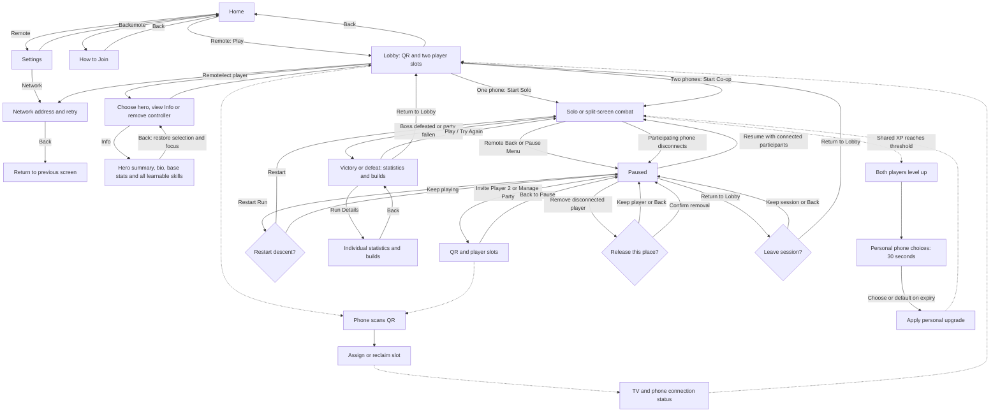

# Implemented game and UI flow

The approved Home design centers the forged-gold logo and carved stone controls: **Play**, **How to Join**, **Settings**, and a separate **Exit**. Play is focused initially. Settings opens the functional local-network controls, and Back from those controls returns to Settings. Exit and Back from Home require confirmation.

The lobby shows **Scan to Join**, the QR, and **Same Wi-Fi**. The TV has one party; players do not enter or see room codes. Network addresses and connection troubleshooting belong in the advanced Network panel. The QR area displays an explicit offline/network error instead of an empty frame if hosting is unavailable.

Character selection offers **Info** for the selected hero: a short summary and bio, base combat stats, and the complete class-eligible skill list with effects. This reference uses the same stats and class rules as combat and includes skills regardless of current run ranks. Back preserves the character choice and restores focus.

One connected phone enables **Start Solo**; two enable **Start Co-op**. Player 2 is optional and can join before starting or through **Pause -> Invite Player 2**. When both places are occupied or reserved, that action reads **Manage Party**. The invite screen preserves the active session and player slots. Back returns to the pause menu; Resume returns to the session. Returning to the lobby requires confirmation and keeps connected phones.

If any participating phone disconnects, the session pauses. Pause names the disconnected Player I/II and counts down its 45-second reconnect reservation. The remote can confirm a direct **Remove Player I/II** action without opening the invite screen. Reconnection or releasing the missing place restores Resume when the remaining participants are connected. A phone that reconnects during the removal confirmation is kept. The run and personal upgrade clocks remain frozen until Resume.

Phones automatically join and show assigned identity, reconnect, and clear rejection messages. During gameplay the page becomes a dedicated controller: Player I/II, joystick, and Dodge with input availability. At a shared level-up, each phone gets its own three upgrade choices and a 30-second host-authoritative timer in a dedicated skill-card view. Combat continues while either player chooses. Health and combat statistics belong on the TV. Pause/invitation and results show concise host-owned status. Phones do not have Ready or shared menu controls. The TV remote owns starting, pause, invitation, and navigation.

The dedicated upgrade view shows only three illustrated dark-fantasy skill cards and the timer. Each card shows its skill emblem, meaningful category, next rank, exact effect headline and current → next values from the simulation. Portrait stacks all three cards; landscape uses three columns. Safe-area padding and contained card scrolling handle short screens while the timer stays visible. Opening an offer releases held movement/Dodge and gates pointer/keyboard gameplay input; combat continues. Clicking keeps the cards visible until the host clears or replaces the offer. Pause/invite/background disable selection without losing the view, and reconnect restores the host offer. The controller returns after acknowledgment or host expiry.

The approved orb HUD (2026-11-13) anchors a red health orb in a forged rim at each lower outer edge: Player I gold, Player II teal. Adjacent health and shared-XP rails show live health, party level and XP. Five skill slots show acquired emblems and their actual current ranks, with owned weapon traits first and then catalog order; +N counts further unique acquired skills. Empty/unselected offers do not create equipped skills, and no base weapon is assigned a fake rank. Dodge shows readiness/cooldown beside the build. The timer/rewards remain at the top center, with a small Back/Pause hint. No large panels, report boxes, portraits or repeated class names cover the fight. Expanded build inspection from Pause remains future work; detailed builds stay behind Results → Run Details.

In split screen, a living player's view shows a small edge chevron and player label when their fallen companion is off-screen. When the companion is visible, a concise stand-near hint changes to **Reviving** with a percentage and thin progress rail. The fallen player's own HUD shows **Awaiting Ally** or revival progress. These cues reuse the current fonts and pixel texture and leave the boss and notification lanes clear.

A conditional boss lane below the timer supports an encounter name/phase and slim health rail; it stays hidden during ordinary combat. Single-line timed notifications sit just below the timer or below an active boss lane. Start/join/downed/revival/low-health/final-thirty-second events use concise titles without explanation cards. The three-slot queue and pause behavior are unchanged. F4 toggles a labeled boss-HUD preview for review; the actual encounter reads live boss health/phase from the simulation.

Shared XP from collected souls advances the party together. Each player HUD shows the same level and XP progress. Upgrade choices affect only the choosing player, queue independently for additional earned levels, and auto-pick the first offer on expiry. Pause/background/disconnect freeze the timers; reconnect preserves an existing choice. A late companion receives catch-up choices.

The remote can select Warden or Ranger on each inactive lobby/invite slot. Both attack automatically with distinct weapons. Twelve encounter phases across twenty minutes lead to a final boss with ground warnings and an enraged second phase. Victory requires killing it; the party falling ends the run. The approved outcome screens use a painted dawn Victory scene or cold Defeat scene, with a short live summary and Play/Try Again, Return to Lobby and Run Details. The secondary Run Details view uses unboxed hero illustrations, prominent stat highlights and illustrated skill ranks; Back restores focus to Run Details. Persistent meta progression remains future work. Gameplay artwork remains temporary pending the later isometric art pass.

Result titles and live controls are available immediately while one bounded worker prepares the active outcome background. The existing backdrop remains visible until the approved scene is ready; opening Run Details preserves that request, and leaving results cancels it. No separate loading menu is introduced.
