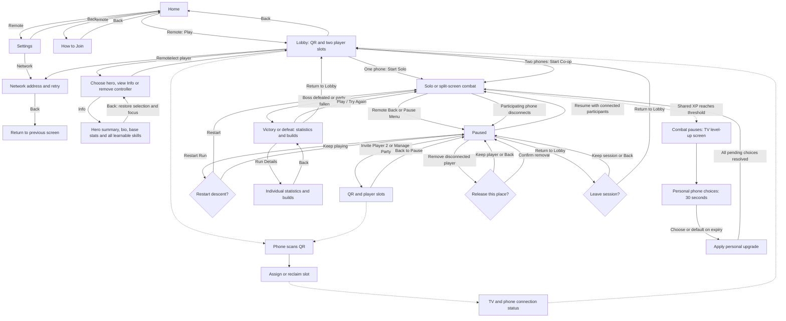

# Implemented game and UI flow

The approved Home design centers the forged-gold logo and carved stone controls: **Play**, **How to Join**, **Settings**, and a separate **Exit**. Play is focused initially. Settings opens the functional local-network controls, and Back from those controls returns to Settings. Exit and Back from Home require confirmation.

The lobby shows **Scan to Join**, the QR, and **Same Wi-Fi**. The TV has one party; players do not enter or see room codes. Network addresses and connection troubleshooting belong in the advanced Network panel. The QR area displays an explicit offline/network error instead of an empty frame if hosting is unavailable.

Character selection offers **Info** for the selected hero: a short summary and bio, base combat stats, and the complete class-eligible skill list with effects. This reference uses the same stats and class rules as combat and includes skills regardless of current run ranks. Back preserves the character choice and restores focus.

One connected phone enables **Start Solo**; two enable **Start Co-op**. Player 2 is optional and can join before starting or through **Pause -> Invite Player 2**. When both places are occupied or reserved, that action reads **Manage Party**. The invite screen preserves the active session and player slots. Back returns to the pause menu; Resume returns to the session. Returning to the lobby requires confirmation and keeps connected phones.

Pause retains the original stacked composition over dimmed frozen gameplay: title and concise live connection status above one centered vertical column of five to seven painted actions. Each action preserves the full 1024:224 artwork ratio, with matching normal/focused/disabled bounds; six/seven-action menus scale the entire plates uniformly to fit the TV viewport; the resident panel and textures are reused. A small footer explains that combat and choice timers are frozen.

If any participating phone disconnects, the session pauses. Pause names the disconnected Player I/II and keeps their place for the current run until the host removes them or leaves the run; lobby-only reservations still expire after 45 seconds. The remote can confirm a direct **Remove Player I/II** action without opening the invite screen. Reconnection or releasing the missing place restores Resume when the remaining participants are connected. A phone that reconnects during the removal confirmation is kept. The run and personal upgrade clocks remain frozen until Resume.

Phones automatically join and show assigned identity, reconnect, and clear rejection messages. During gameplay the page becomes a portrait-only controller: Player I/II, a top 75% movement area and a bottom 25% rectangular Dodge button with input availability. The thumbstick is hidden at rest; every fresh press in the top area spawns it under that finger. Pointer capture keeps movement active outside its starting area and across the lower boundary, independently of a second Dodge thumb. Touches that begin in the bottom area only Dodge. At a shared level-up, each phone gets its own three upgrade choices and one shared 30-second host-authoritative timer in a dedicated skill-card view. Combat and the arena clock pause while either player chooses. The TV displays LEVEL UP, CHECK YOUR PHONE, one large countdown inside an original gold crest and compact player-ready labels, without avatars. Bounded gold radiance uses the existing atlas over frozen gameplay. Play resumes automatically after all skill choices resolve. Health and combat statistics belong on the TV. Pause/invitation and results show concise host-owned status. Phones do not have Ready or shared menu controls. The TV remote owns starting, pause, invitation, and navigation.

The dedicated upgrade view shows only three illustrated dark-fantasy skill cards and the timer. Each card shows its skill emblem, meaningful category, next rank, exact effect headline and current → next values from the simulation. Phones use portrait only, stacking all three cards. Turning sideways shows an upright-phone prompt and releases gameplay input; returning upright restores the host-owned choice. Safe-area padding and contained card scrolling handle short screens while the timer stays visible. Opening a skill offer releases held movement/Dodge and gates gameplay input for the whole party while skill-choice timers continue. A finished player sees a waiting message until their companion finishes. Gear offers use two illustrated equipment cards with the same global pause and shared countdown in a LOOT FOUND ceremony; skill offers retain three cards. Clicking keeps the cards visible until the host clears or replaces the offer. Pause/invite/background disable selection without losing the view, and reconnect restores the host offer. The controller returns after acknowledgment or host expiry.

The approved HUD revision (2026-11-23) uses larger, smooth-rimmed 176-pixel health orbs at the lower outer edges: Player I gold, Player II teal. Health is represented by the liquid fill, without numeric HP or a duplicate health rail. At 20% effective maximum health or below, a living player's orb gains a soft local 1.6-second pulse and LOW HEALTH caption; it clears after healing and is replaced by downed/revival feedback when fallen. The pulse freezes during manual pause. Five skill slots use 80-pixel acquired emblems in 88-pixel frames with larger actual-rank badges; owned weapon traits lead, +N counts further unique acquired skills, and empty offers never create skills. A new original painted boot/trail Dodge icon stays immediately beside the health orb with a cooldown ring and numerical countdown, without a Dodge or Ready label. Its location is fixed even when no skill emblems have been acquired. Fallen players retain their own down/revival state and ally guidance.

One shared party XP rail and level label stay in a fixed bottom lane, including during boss fights. The top shows only a survival timer or the approved smaller painted boss header: hollow sovereign mask, worn iron/gold frame, live crimson health fill and one live boss-name line. The timer is hidden during the boss encounter; Slain/Souls counters, BOSS/phase labels and routine top banners are removed. The former Back/Pause hint and repeated personal health/XP text are removed. No large panels, portraits or repeated class names cover the fight. All HUD art fits one managed 512×352 atlas (0.6875 MiB GPU, no retained decoded Pixmap); see [HUD art provenance](hud-art.md). F10 opens the populated level-12 HUD preview; repeat F10 to alternate normal/critical P1 health. Expanded build inspection from Pause remains future work; detailed builds stay behind Results → Run Details.

In split screen, a living player's view shows a small edge chevron and player label when their fallen companion is off-screen. When the companion is visible, a concise stand-near hint changes to **Reviving** with a percentage and thin progress rail. The fallen player's own HUD shows **Awaiting Ally** or revival progress. These cues reuse the current fonts and pixel texture and leave the boss and notification lanes clear.

The painted boss frame and fill are separate atlas regions. The fill clips from left to right using live boss health rather than scaling a flattened screenshot; the name remains cached live text. F4 toggles the boss HUD development preview. Player low-health, downed and revival cues remain beside their orb or companion rather than adding repeated text to the boss header. The tiny living-player colour bar beneath hero sprites is removed; downed revival progress is retained.

Shared XP from collected souls advances the party together. The shared bottom HUD shows party level and XP progress. Upgrade choices affect only the choosing player, queue personal choices for additional earned levels, opening each shared 30-second round after the current party round finishes, and auto-pick the first offer on expiry. Pause/background/disconnect freeze the timers; reconnect preserves an existing choice. A new late companion receives defaults for all earlier rewards; only future rewards offer personal choices.

The remote can select Warden or Ranger on each inactive lobby/invite slot. Both attack automatically with distinct weapons. Twelve encounter phases across twenty minutes lead to a final boss with ground warnings and an enraged second phase. Victory requires killing it; the party falling ends the run. The approved outcome screens reuse the simplified menu crypt with distinct Victory/Defeat titles, subtle orb lighting, a short live summary and Play/Try Again, Return to Lobby and Run Details. The secondary Run Details view uses unboxed hero illustrations, prominent stat highlights and illustrated skill ranks; Back restores focus to Run Details. Persistent meta progression remains future work. The open crypt now uses taller borders and authored visual landmark groups; interior scenery adds no movement obstacles. See [implemented arena layout](arena-redesign-proposal.md).

Home, lobby/invite, hero info and results share the simplified layered crypt, with no fire or fog. Victory/Defeat retain their distinct prewarmed titles and a restrained orb-light adjustment; no background decode or scene upload occurs at the transition. Run Details adds the existing scrim over the shared scene. Pause retains dimmed frozen gameplay beneath its shared panel.

The November 24 end-screen polish uses the approved character-selection portraits in both outcomes and Run Details. Labeled run highlights sit over a mild dark backing; three painted actions provide replay, lobby and details navigation. Replay labels and connection status explain the current solo/co-op party. Run Details keeps four readable skill/equipment entries per page with remote Previous/Next controls and stable portraits. Phones distinguish Victory and Defeat while the remote owns shared actions. See [end-screen behavior and verification](end-screens.md).

Equipment pauses combat and the arena clock, showing LOOT FOUND / CHECK YOUR PHONE on TV with the existing gold crest, one shared countdown and compact ready indicators. Each loot round has a shared 30-second window; completed players wait and queued rewards receive fresh windows. Equipment uses a dedicated two-card phone view with an EQUIPMENT heading, slot, original item illustration, replacement identity and complete old → new item bonuses. Portrait stacks the two equipment cards; the same upright-phone prompt replaces landscape. Skill choices remain three cards. The TV ceremony and phone show the stored reward source, such as ELITE DEFEATED or CHEST DISCOVERED. Keep Current Gear declines the current loot choice; it is a personal build action, not shared menu navigation. Selection/decline stays visible until host acknowledgment. Skill choices take priority; hidden equipment countdowns freeze and ineligible offers refresh after intervening skill changes. Both clocks freeze during pause/invite/background/disconnect. Run Details adds a remote-controlled View Equipment / View Skills switch, retaining the existing unboxed character/build presentation and Back to Summary action. Combat HUD materials/layout remain unchanged and show effective health/Dodge values.

Gear comes from up to five elite chests and three discoverable arena chests. An elite death leaves a chest at its world position and does not open the picker. After a brief landing delay, either living player walking within 40 world units collects it and earns one shared reward with personal choices. Chests remain until collected or the run resets; pickup-range bonuses do not pull them in. Only collected rewards count toward automatic late-join equipment; an uncollected chest can be collected by either participant after joining. Multiple nearby chests open one round at a time, with remaining chests staying in the frozen arena during choices. In the twenty-minute run, the three arena chests appear at random interior locations at 90, 600 and 1140 elapsed combat seconds (1:30, 10:00 and 19:00). Chest appearance does not open offers, announce a reward or pause combat. They appear away from living players and existing chests, use the approved chest art/light, and persist for discovery. The CHEST DISCOVERED label appears only after collection, while its original scheduled time stays in the stored provenance. These are chest-appearance times on the encounter clock, not wall-clock waiting times: choice/manual/background/disconnect pauses freeze combat time. A reward earned while skills are pending waits until the skill rounds finish, then opens with a fresh shared loot window. Its stored source stays attached to the entitlement while queued or reconnected, rather than being guessed from the clock when the card appears. The display explains the reward mechanism; it does not establish which event occurred in an unrecorded user playtest.

New late joiners receive all earlier skill ranks and gear rewards automatically from fixed class-appropriate defaults. They see only “Starter build equipped—you’re ready” beside the controller and can move/Dodge immediately after Resume. There are no inherited cards, catch-up timers or build-review step. Future rewards use the existing personal 30-second choices. Reconnecting an existing participant keeps health, build, offer IDs and remaining timers, with no new default grants.

Portrait-controller verification (2026-11-25): focused controller checks cover fresh drags outside the visible ring, independent movement/Dodge touches, neutral release/cancellation and rotation, portrait-only choices, pause and reconnect. A real headless mobile browser checked 390×844 and 320×568 portrait selection/decline/scrolling, two-thumb touch input and the sideways prompt using the production page with deterministic host-status fixtures. The subsequent 75/25 revision also verified the exact area ratio, stick birth/retouch coordinates, independent zones, neutral release and movement capture across the boundary without an accidental Dodge. Native desktop GL screenshots verified proportional focused/unfocused summary plates on Victory and Defeat. JDK 21 desktop compilation, Android debug assembly and the focused results tests passed. The TV/emulator and LAN relay were untouched; physical-phone feel remains for user playtesting.

Pause-menu polish verification (2026-11-25): JDK 21 built desktop classes and the Android debug APK; twelve focused pause/input/skill/loot checks passed. A brief native desktop fixture rendered the final stacked pause composition over the frozen arena for solo, one missing companion and both phones missing; header, status, footer and every action fit the 1920×1080 viewport. It checked proportional button bounds, all seven actions fitting the viewport, remote focus/disabled Resume, reconnect focus restoration, Back from Audio/Restart/Return/Remove, and frozen combat/choice clocks. No texture resources were added. The running TV and phone relay were left intact.
