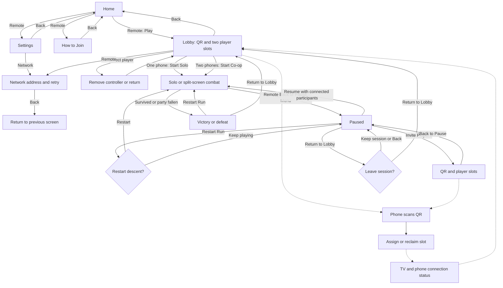

# Implemented game and UI flow

The approved Home design centers the forged-gold logo and carved stone controls: **Play**, **How to Join**, **Settings**, and a separate **Exit**. Play is focused initially. Settings opens the functional local-network controls, and Back from those controls returns to Settings. Exit and Back from Home require confirmation.

The lobby shows **Scan to Join**, the QR, and **Same Wi-Fi**. The TV has one party; players do not enter or see room codes. Network addresses and connection troubleshooting belong in the advanced Network panel. The QR area displays an explicit offline/network error instead of an empty frame if hosting is unavailable.

One connected phone enables **Start Solo**; two enable **Start Co-op**. Player 2 is optional and can join before starting or through **Pause -> Invite Player 2**. The invite screen preserves the active session and player slots. Back returns to the pause menu; Resume returns to the session. Returning to the lobby requires confirmation and keeps connected phones. If any participating phone disconnects, the session pauses. Reconnect it, or remove its slot under Invite Player 2 before resuming.

Phones automatically join and show assigned identity, reconnect, and clear rejection messages. During gameplay the page becomes a dedicated controller: Player I/II, joystick, and Dodge with input availability. Health and combat statistics belong on the TV. Pause/invitation and results show concise host-owned status. Phones do not have Ready or shared menu controls. The TV remote owns starting, pause, invitation, and navigation.

The TV combat HUD keeps framed player vitals in the lower outer corners (Player I gold, Player II teal), a carved timer/reward crest at the top center, and a small Back/Pause hint at the bottom center. The middle remains available for the fight. A reserved boss lane below the timer supports encounter name, phase, and segmented health; it is hidden during ordinary combat. No boss gameplay is added by this UI pass.

A separate notification lane below the boss lane shows timed messages for descent start, joining, falling/revival, low health, and the final thirty seconds. The three-slot queue suppresses duplicates, protects the active message, and allows warnings to replace the oldest waiting message when full. Notices freeze while paused. F4 toggles an explicitly labeled boss HUD preview during a session for visual review; this does not create or damage an enemy.

Character selection, distinct class weapons, upgrades, boss combat, and progression remain future work. Gameplay artwork remains temporary pending the later isometric art pass.
