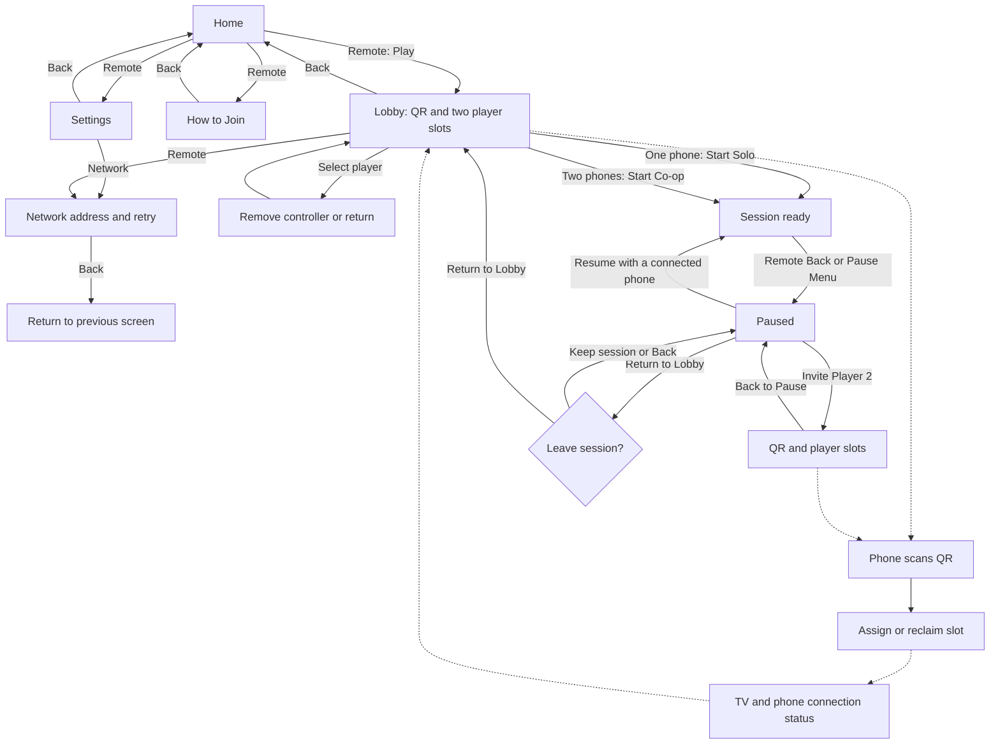

# Implemented lobby and pause flow

The approved Home design centers the forged-gold logo and carved stone controls: **Play**, **How to Join**, **Settings**, and a separate **Exit**. Play is focused initially. Settings opens the functional local-network controls, and Back from those controls returns to Settings. Exit and Back from Home require confirmation.

The lobby shows **Scan to Join**, the QR, and **Same Wi-Fi**. The TV has one party; players do not enter or see room codes. Network addresses and connection troubleshooting belong in the advanced Network panel. The QR area displays an explicit offline/network error instead of an empty frame if hosting is unavailable.

One connected phone enables **Start Solo**; two enable **Start Co-op**. Player 2 is optional and can join before starting or through **Pause -> Invite Player 2**. The invite screen preserves the active session and player slots. Back returns to the pause menu; Resume returns to the session. Returning to the lobby requires confirmation and keeps connected phones. If all phones disconnect, the session pauses and Resume remains disabled until a controller reconnects.

Phones have connection UI only: automatic joining, assigned player identity, connection status, reconnect, and clear rejection messages. They do not have Ready or shared menu controls. The TV remote owns starting, pause, invitation, and navigation. The initial focus stays visible; disabled Start/Resume controls cannot be activated.

The session-ready surface is an explicit handoff for future gameplay and states that gameplay begins in the next milestone. It is not a simulated run. Character choice, countdown, movement, split-screen gameplay, upgrades, and results remain future work.
