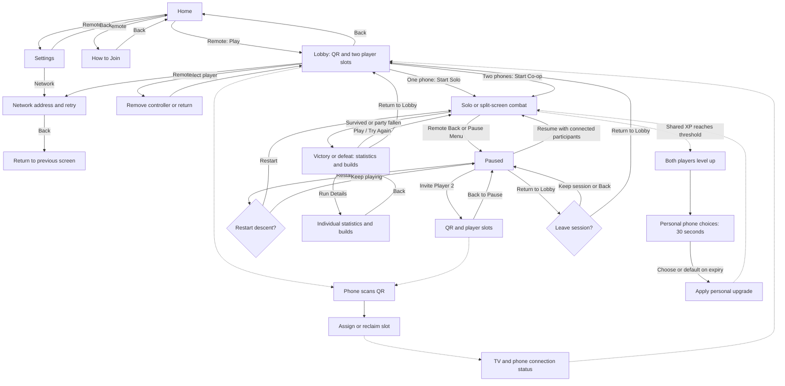

# Implemented game and UI flow

The approved Home design centers the forged-gold logo and carved stone controls: **Play**, **How to Join**, **Settings**, and a separate **Exit**. Play is focused initially. Settings opens the functional local-network controls, and Back from those controls returns to Settings. Exit and Back from Home require confirmation.

The lobby shows **Scan to Join**, the QR, and **Same Wi-Fi**. The TV has one party; players do not enter or see room codes. Network addresses and connection troubleshooting belong in the advanced Network panel. The QR area displays an explicit offline/network error instead of an empty frame if hosting is unavailable.

One connected phone enables **Start Solo**; two enable **Start Co-op**. Player 2 is optional and can join before starting or through **Pause -> Invite Player 2**. The invite screen preserves the active session and player slots. Back returns to the pause menu; Resume returns to the session. Returning to the lobby requires confirmation and keeps connected phones. If any participating phone disconnects, the session pauses. Reconnect it, or remove its slot under Invite Player 2 before resuming.

Phones automatically join and show assigned identity, reconnect, and clear rejection messages. During gameplay the page becomes a dedicated controller: Player I/II, joystick, and Dodge with input availability. At a shared level-up, each phone gets its own three upgrade choices and a 30-second host-authoritative timer alongside the controls. Combat continues while either player chooses. Health and combat statistics belong on the TV. Pause/invitation and results show concise host-owned status. Phones do not have Ready or shared menu controls. The TV remote owns starting, pause, invitation, and navigation.

The TV combat HUD uses small player vitals at the lower outer edges (Player I gold, Player II teal), a plain timer and reward counts at the top center, and a small Back/Pause hint. There are no boxed panels, portraits, repeated class names, or carved timer slab. Thin health rails and subtle text shadows keep it readable while leaving the fight visible.

A conditional boss lane below the timer supports an encounter name/phase and slim health rail; it stays hidden during ordinary combat. Single-line timed notifications sit just below the timer or below an active boss lane. Start/join/downed/revival/low-health/final-thirty-second events use concise titles without explanation cards. The three-slot queue and pause behavior are unchanged. F4 toggles a labeled boss-HUD preview for review; the actual encounter reads live boss health/phase from the simulation.

Shared XP from collected souls advances the party together. Each player HUD shows the same level and XP progress. Upgrade choices affect only the choosing player, queue independently for additional earned levels, and auto-pick the first offer on expiry. Pause/background/disconnect freeze the timers; reconnect preserves an existing choice. A late companion receives catch-up choices.

The remote can select Warden or Ranger on each inactive lobby/invite slot. Both attack automatically with distinct weapons. Three wave stages lead to a final boss with ground warnings and an enraged second phase. Victory requires killing it; the party falling ends the run. The approved outcome screens use a painted dawn Victory scene or cold Defeat scene, with a short live summary and Play/Try Again, Return to Lobby and Run Details. The secondary Run Details view uses unboxed hero illustrations, prominent stat highlights and illustrated skill ranks; Back restores focus to Run Details. Persistent meta progression remains future work. Gameplay artwork remains temporary pending the later isometric art pass.
